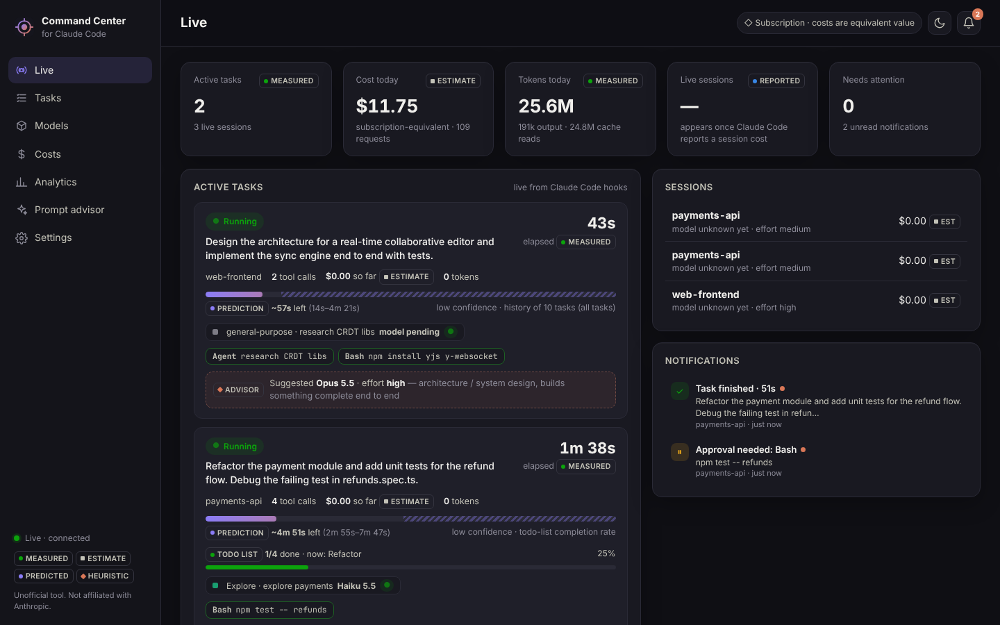
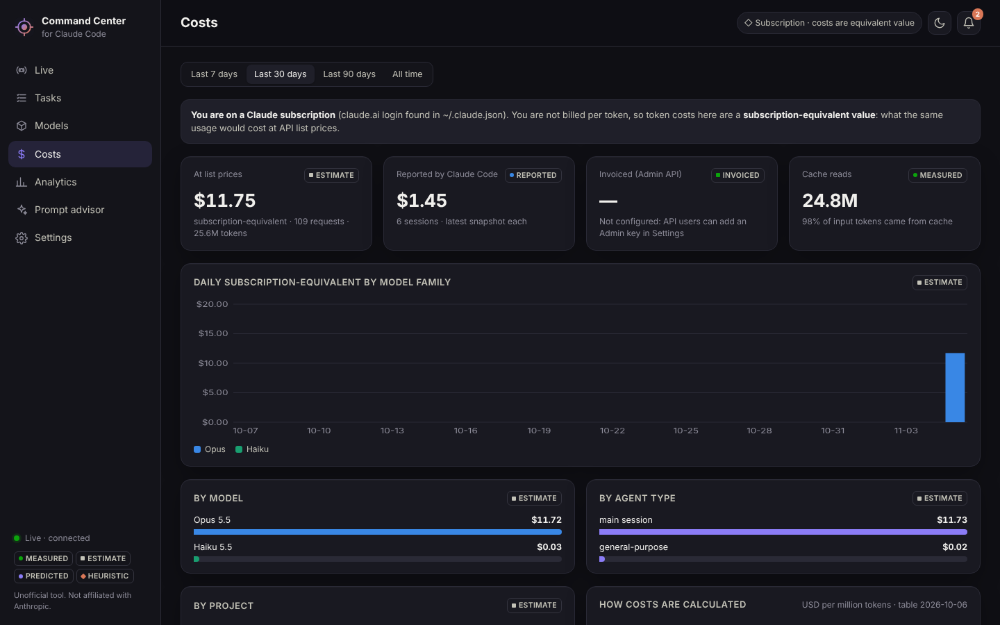
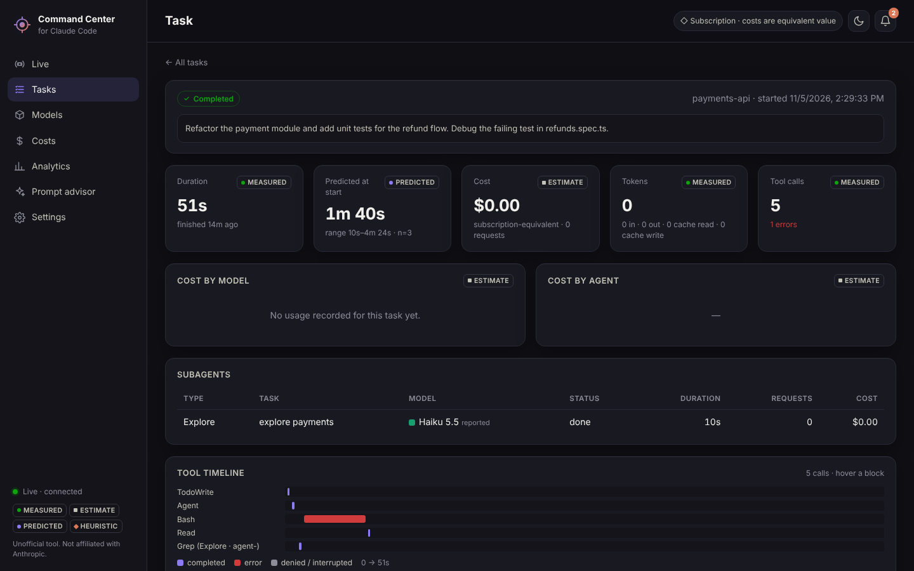
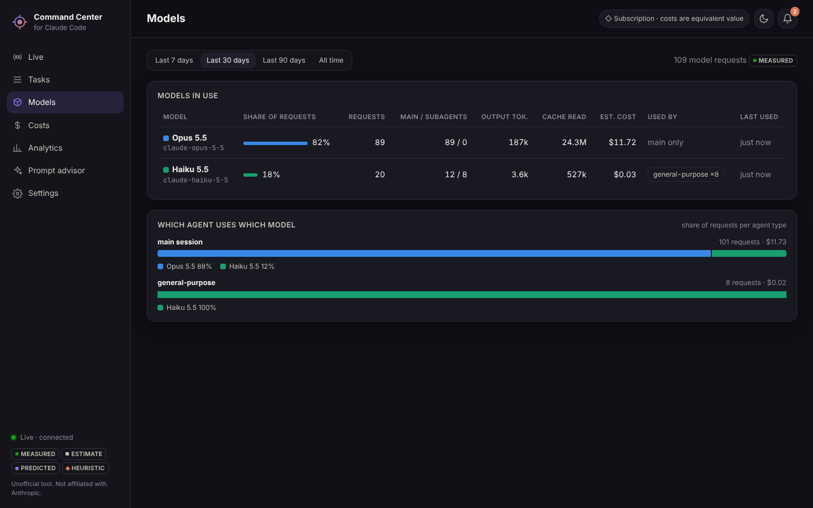
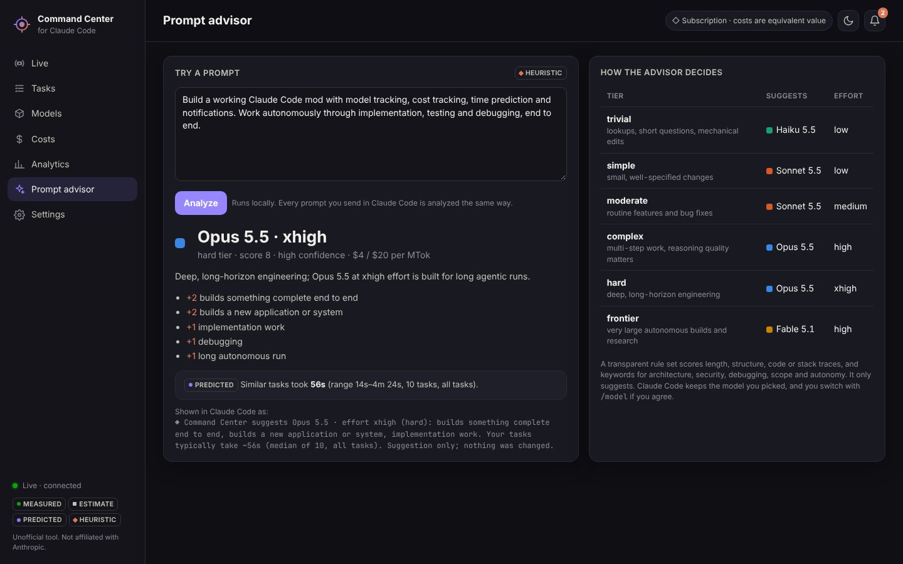

# Claude Command Center

A local command center for **Claude Code**. It shows which models and agents are working, what they cost, how long a task should take, which model a prompt deserves, and taps you on the shoulder when a task finishes, fails or needs you.

> Unofficial tool, not affiliated with Anthropic. Everything runs on your computer; nothing is sent anywhere.



| | |
|---|---|
|  |  |
|  |  |

*The screenshots combine the test scenario from `test/helpers.js` with real usage recorded on the build machine.*

## What it does

| Feature | How |
|---|---|
| **Model tracking** | Every model request in Claude Code's transcripts carries the model that served it. Command Center counts them per model, per session and per **agent**: the main session and each subagent type (Explore, general-purpose, your own agents). |
| **Cost tracking** | Measured tokens (input, output, cache reads, 5-minute and 1-hour cache writes) × published list prices, per task, model and agent. Kept apart: **Claude Code's own reported cost**, the **invoiced** amount from the Anthropic Admin API (optional), and whether you are on a **subscription** (the value is *subscription-equivalent*) or **API billing** (an *estimate* of spend). |
| **Time prediction** | Remaining time is predicted from your own measured history of similar tasks, conditioned on time already spent, blended with Claude's todo-list progress. Every prediction is scored when the task ends, and a per-tier calibration factor corrects later ones. With too little history it says so instead of guessing. |
| **Prompt intelligence** | Every prompt is scored with transparent rules (scope, structure, code, stack traces, keywords for architecture, security, debugging, autonomy). It suggests a model and effort level, with the reasons, in one line under your prompt. **It never changes your model.** |
| **Live monitoring** | Active tasks, running tools, subagents and their models, todo progress, tool errors, permission prompts and background agents, live from Claude Code hooks. |
| **Notifications** | Native Windows toasts (plus in-dashboard) when a task finishes, fails, hits repeated tool errors, waits for approval, asks a question or waits for your input. |
| **Analytics** | Daily cost by model family, model × agent distribution, cost by project, task performance by complexity tier, prediction accuracy over time, advisor vs actual model, and an activity heatmap. |

### The panel inside Claude Code

In **local** Claude Code sessions (the desktop app's Code tab on a folder on your computer, or the terminal) a **Command Center panel** opens beside the chat. It shows active tasks with elapsed time, predicted time left, todo progress, subagents and their models, running tools, cost so far, alerts and recent tasks, and adds a short status entry such as `◆ 1 running · ~52s left (pred.) · $17.31 today`. Type `/cc-panel` to show or hide it, and use **Open full dashboard** for the window. The panel is built on Claude Code's early-access mod API (function hooks), so a future Claude Code update may change it. Cloud sessions don't draw it.

Every number carries a tag: **measured** (read from Claude Code), **estimate** (tokens × list price), **reported** (Claude Code's own cost), **invoiced** (Admin API), **predicted** (forecast with sample size and basis), **heuristic** (advisor suggestion).

## Install on Windows

**Requirements:** Windows 10 or 11, [Claude Code](https://code.claude.com), and Node.js 18 or newer (`winget install OpenJS.NodeJS.LTS`).

1. Get the files, either by cloning:
   ```powershell
   git clone -b claude/gracious-rubin-rxsdar https://github.com/tojahacko/oooomyboy.git
   ```
   or by downloading the branch as a ZIP from GitHub and extracting it.
2. Open the `claude-command-center\windows` folder and double-click **`install.cmd`**. Or run it from PowerShell:
   ```powershell
   powershell -ExecutionPolicy Bypass -File .\oooomyboy\claude-command-center\windows\install.ps1
   ```
   The installer:
   - copies the app to `%LOCALAPPDATA%\ClaudeCommandCenter`;
   - installs the Claude Code plugin `command-center` through Claude Code's own `claude plugin install`. If the `claude` command is missing, it adds the hooks to `%USERPROFILE%\.claude\settings.json` instead, after making a backup;
   - asks whether to add the status line. It never replaces a status line you already have;
   - registers toast notifications, creates Start menu and Desktop shortcuts, starts the backend, runs a health check and opens the dashboard.

   Options: `-StatusLine`, `-NoStatusLine`, `-Autostart` (start the backend when you sign in), `-NoShortcuts`, `-ManualHooks`, `-NoOpen`.
3. Start a **new** Claude Code session. Your next prompt shows up in the dashboard immediately.

Open the dashboard any time from **Start menu → Claude Command Center**. In Claude Code, run `/command-center:dashboard`, or `/command-center:status` for a text summary. The dashboard opens as its own app window (Edge/Chrome `--app` mode) at `http://127.0.0.1:47821`.

### Alternative: install the plugin from GitHub

In Claude Code:
```
/plugin marketplace add tojahacko/oooomyboy
```
```
/plugin install command-center@ccc
```
The backend starts by itself on your first prompt. Open the dashboard with `/command-center:dashboard`. This route creates no shortcuts and registers no notification name. Toasts still work, but they show "Windows PowerShell" as their source.

### Uninstall

```powershell
powershell -ExecutionPolicy Bypass -File "$env:LOCALAPPDATA\ClaudeCommandCenter\app\windows\uninstall.ps1"
```
This removes the plugin, hooks, status line, shortcuts and program files. Add `-RemoveData` to also delete your history in `%USERPROFILE%\.claude-command-center`.

## How it works

```
 Claude Code ──hooks──▶ cli/ccc-hook.js ──HTTP 127.0.0.1──▶ backend (server/)  ◀──SSE── dashboard window
      │                 (exit 0 always; async for                │                        (dashboard/)
      │                  tool events; spools to disk             ├─ engine.js      task state machine
      │                  if the backend is down)                 ├─ transcripts.js measured usage per message/model/agent
      └──transcripts (~/.claude/projects/*.jsonl) ───────────────┤  predict.js     time prediction + calibration
                                                                 ├─ advisor.js     prompt intelligence
      status line ◀── cli/ccc-statusline.js ◀────────────────────┤  analytics.js   history
                                                                 └─ notify.js      Windows toasts
```

- **Integration** uses only Claude Code's documented extension points: a plugin with command hooks, plus an optional `statusLine` command. Claude Code itself is not modified. The 16 hook events are SessionStart, UserPromptSubmit, PreToolUse, PostToolUse, PostToolUseFailure, PermissionRequest, PermissionDenied, SubagentStart, SubagentStop, Notification, Stop, StopFailure, TaskCreated, TaskCompleted, PreCompact and SessionEnd.
- **Measured usage** comes from Claude Code's transcripts. Each assistant message is written once per content block with the same `message.id`, so records are de-duplicated by that id. Subagent transcripts in `…/subagents/agent-<id>.jsonl` give per-agent model usage.
- **Prompt suggestions** reach you through the hook's `systemMessage`. Claude Code shows it to you and does **not** add it to the model's context. This was verified: the model could not see it.
- **Resource use** (measured): backend about 65 MB RAM, about 0.1% CPU while idle. Each hook takes about 45 ms, and tool hooks run asynchronously, so they never slow Claude down. The dashboard has no dependencies and no build step.
- **Data** stays in `%USERPROFILE%\.claude-command-center` (events, scan cache, settings). The server listens on 127.0.0.1 only, rejects non-local `Host` headers, and requires a custom header on every write.

### Costs, precisely

- List prices per million tokens, from the published model table dated 2026-10-06. Examples: Opus 5.5 $4 / $20 (cache read $0.20), Sonnet 5.5 $2 / $10, Haiku 5.5 $0.10 / $0.50 ($0.50 / $2.50 for prompts over 100K tokens), Fable 5.1 $10 / $50 (cache read $0.25). Cache writes cost 1.25× input (5 minutes) or 2× input (1 hour), and fast mode costs 2×. The full table is on the Costs page.
- A model that is not in the table is shown as **unpriced**. Its cost is never guessed.
- **Check against Claude Code:** in the verification runs, the per-request estimates summed to exactly Claude Code's own `total_cost_usd` and `costUSD` values. For example, $0.00715157 vs $0.00715157 on a recorded session, and $0.006454 vs $0.006454 on a live run.
- **Subscription vs API** is detected from Claude Code's login (`~/.claude.json`) and environment, or set in Settings. API organizations can add an **Admin API key** to see the *invoiced* cost from `GET /v1/organizations/cost_report`.

### Time predictions, precisely

1. History holds tasks finished while Command Center was running, plus tasks reconstructed from older transcripts (prompt to last activity).
2. Each task gets a complexity tier from the advisor. The prediction uses recency-weighted quantiles (p25, p50, p80) of the same tier, falling back to neighbouring tiers and then all tasks; the scope used is always shown.
3. While a task runs, only historical tasks that ran at least as long count ("given it's been 4 minutes…"). When Claude keeps a todo list, its completion rate is blended in.
4. When a task ends, the prediction made at its start is compared with the actual duration, and the median ratio per tier becomes a calibration factor (between 0.5 and 2). Analytics shows whether the error is shrinking.
5. With fewer than 3 relevant finished tasks there is no number. The UI says "not enough history".

## Verify it yourself

```powershell
cd "$env:LOCALAPPDATA\ClaudeCommandCenter\app"
node scripts\verify.js            # tests, plugin validation, hook→backend→API end to end, dashboard smoke test*
node scripts\verify.js --notify   # also shows a real Windows toast
node scripts\verify.js --live     # also runs a real Claude Code session on Haiku (costs < $0.02) and
                                  # checks the measured task cost against Claude Code's total_cost_usd
node cli\ccc.js doctor            # checks the whole chain and says exactly what is missing
```
\* The browser smoke test runs when `playwright` is installed (`npm i -g playwright`); otherwise it is skipped.

## Command line

`node cli\ccc.js <command>`: `open`, `start`, `stop`, `status`, `doctor`, `summary`, `notify-test`, `statusline install|uninstall [--force]`, `hooks install|uninstall`, `run` (foreground).

Environment variables: `CCC_PORT` (default 47821), `CCC_HOME` (data folder), `CLAUDE_CONFIG_DIR` (if you moved Claude Code's folder), `CCC_NO_AUTOSTART=1`.

## Troubleshooting

- **Nothing appears in the dashboard:** run `node cli\ccc.js doctor`. Then start a new Claude Code session, because hooks load at session start. In Claude Code, `/hooks` lists the active hooks.
- **Every event counted twice:** both the plugin and manual hooks are active. Run `node cli\ccc.js hooks uninstall`.
- **No toasts:** check Windows Settings → System → Notifications (and Focus Assist), and run `node cli\ccc.js notify-test`.
- **Port in use:** set `CCC_PORT` (user environment variable) to another port and restart Claude Code.
- **Logs:** `%USERPROFILE%\.claude-command-center\server.log`.

## Known limitations

- The backend, hooks, plugin install, status line and slash commands were verified against Claude Code 2.1.318 in a Linux build environment, including live sessions. The Windows-only parts (PowerShell installer, toasts, shortcuts, the Edge app window) could not be executed there. If any step fails on your machine, `doctor` and the installer print exactly which one.
- Durations of tasks from before installation are approximate (prompt to last transcript activity).
- The advisor is a rule-based heuristic, not a model call. It is fast, free, private and explainable, and it can be wrong.
- Bedrock and Vertex AI have their own pricing. Costs here use Anthropic first-party list prices.

## Development

```bash
npm test                 # 28 unit/integration tests (node:test, no dependencies)
node scripts/verify.js   # end-to-end report
node cli/ccc.js run      # backend in the foreground
```
The dashboard is plain HTML, CSS and JS in `dashboard/` with no build step. Icons are regenerated with `node tools/make-icons.js`, which needs playwright.
